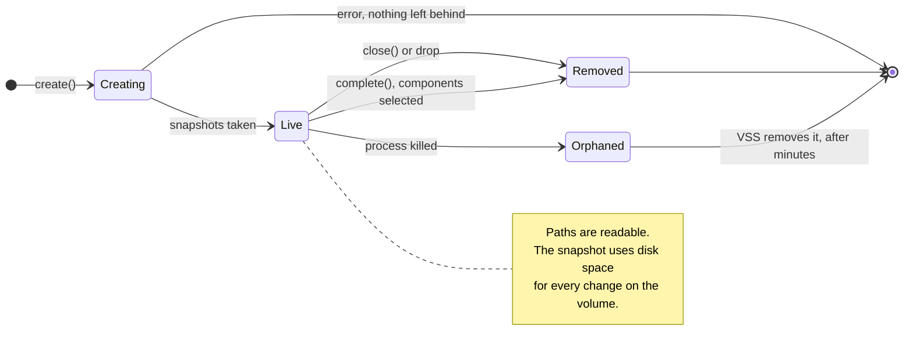
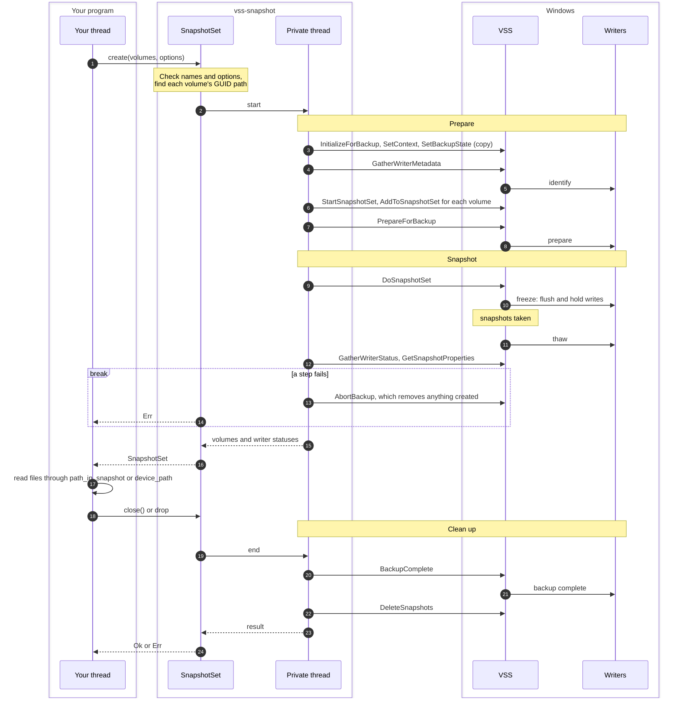
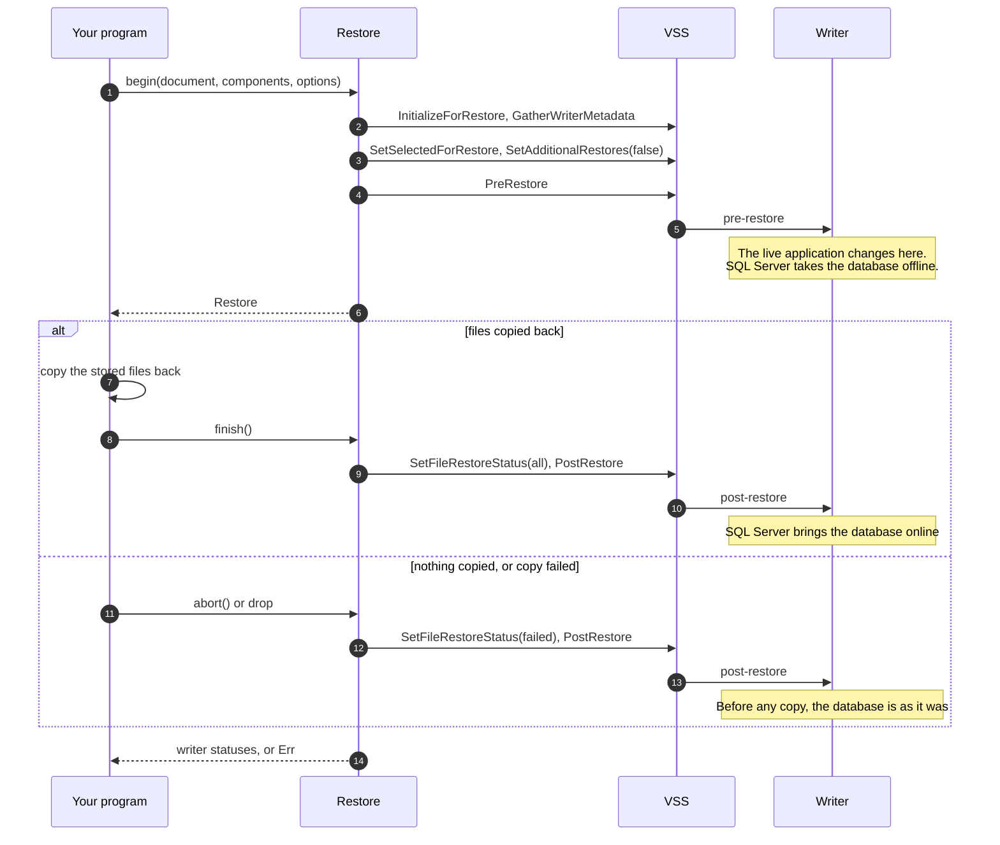

# vss-snapshot interface

This document defines the public interface of `vss-snapshot`: its types, their lifecycle, the
errors, threading, the privileges it needs, what it guarantees about cleanup, and what it
deliberately doesn't do. The rustdoc on each item is the detailed reference. Where they differ,
this document states the intent and the rustdoc is a bug.

**Status:** implemented. Backup and restore through writers is tested with SQL Server
Express only.

## Contents

1. [Overview](#overview)
2. [Public API](#public-api)
3. [Lifecycle](#lifecycle)
4. [Errors](#errors)
5. [Threading](#threading)
6. [Privileges and requirements](#privileges-and-requirements)
7. [Cleanup guarantees](#cleanup-guarantees)
8. [Behaviour worth knowing](#behaviour-worth-knowing)
9. [Out of scope](#out-of-scope)
10. [Stability](#stability)

## Overview

`vss-snapshot` takes temporary, read-only Volume Shadow Copy (VSS) snapshots of one or more
Windows volumes, all at the same moment, so a program can read every file as it was then,
including files that are open or locked.

It does three things:

- **Snapshots.** Create a set of snapshots, map live paths into them, and remove them.
- **Writer status and metadata.** Report which VSS writers (SQL Server, Exchange, the registry,
  and so on) prepared their files, and list what each writer looks after.
- **Backup and restore through writers.** Select writer components so a backup can later be
  restored through the writer, and drive that restore.

It doesn't copy files, schedule anything or store backups. Those belong to the program using it.

On non-Windows targets the crate compiles to nothing, so it can sit behind a
`[target.'cfg(windows)'.dependencies]` entry or be built for documentation anywhere.

## Public API

Everything below is re-exported at the crate root. Nothing else is public. All COM and VSS calls
live in a private module, and no type from the `windows` crate appears in the public API, so a
`windows` upgrade is never a breaking change here.

### Taking a snapshot

```rust
/// Snapshots of one or more volumes, all taken at the same moment.
/// Removed by `close`, `complete` or drop.
pub struct SnapshotSet { /* private */ }

impl SnapshotSet {
    /// Takes a snapshot of each volume. A volume is named by drive (`C`, `C:`, `C:\`),
    /// by GUID path (`\\?\Volume{...}\`), or by a folder it is mounted on (`C:\mnt\data\`).
    /// Naming the same volume twice takes one snapshot.
    pub fn create<I, S>(volumes: I, options: &SnapshotOptions) -> Result<SnapshotSet>
    where
        I: IntoIterator<Item = S>,
        S: AsRef<str>;

    /// The snapshot set's VSS id.
    pub fn id(&self) -> Guid;

    /// One entry per volume, in the order first named.
    pub fn volumes(&self) -> &[VolumeSnapshot];

    /// The entry for a volume, by any name `create` accepts for it.
    pub fn volume(&self, name: &str) -> Option<&VolumeSnapshot>;

    /// Turns a path on a live volume into the same path inside its snapshot.
    /// Picks the volume whose mount point is the longest match. `None` if no volume
    /// in the set holds the path, or the path is relative or contains `..`.
    pub fn path_in_snapshot(&self, path: &Path) -> Option<PathBuf>;

    /// What each writer reported once the snapshot was taken. Empty for
    /// `Consistency::Crash`.
    pub fn writers(&self) -> &[WriterStatus];

    /// Removes the snapshots and reports any failure, which drop can't.
    /// If components were selected, their writers are told the backup failed.
    pub fn close(self) -> Result<()>;

    /// Tells the writers of the selected components that the backup succeeded,
    /// removes the snapshots, and returns the document a restore needs.
    /// Call only once the backup is safely stored.
    /// Fails with `Error::InvalidOptions` if no components were selected.
    pub fn complete(self) -> Result<BackupDocument>;
}

impl Drop for SnapshotSet { /* removes the snapshots, ignoring failures */ }
```

```rust
/// One volume's snapshot within a `SnapshotSet`.
#[derive(Debug, Clone, PartialEq, Eq)]
pub struct VolumeSnapshot { /* private */ }

impl VolumeSnapshot {
    /// The snapshot's VSS id.
    pub fn id(&self) -> Guid;
    /// The volume as first named, normalised: `C:\`, or `\\?\Volume{...}\`.
    pub fn name(&self) -> &str;
    /// The volume's GUID path, `\\?\Volume{...}\`. Stable across reboots and drive
    /// letter changes, so use it in saved state.
    pub fn guid_path(&self) -> &str;
    /// Every place the volume is mounted, such as `C:\` and `D:\data\`, when created.
    pub fn mount_points(&self) -> &[PathBuf];
    /// The snapshot's root, `\\?\GLOBALROOT\Device\HarddiskVolumeShadowCopyN\`.
    /// Valid until the set is removed. Open it to read files, or as a volume.
    pub fn device_path(&self) -> &Path;
    /// When VSS created the snapshot.
    pub fn created(&self) -> SystemTime;
    /// Maps a path on this volume, by any of its mount points or its GUID path,
    /// into this snapshot.
    pub fn path_in_snapshot(&self, path: &Path) -> Option<PathBuf>;
}
```

### Options

```rust
/// How to create a `SnapshotSet`. Built with chained methods, so fields can be
/// added later without breaking callers.
#[derive(Debug, Clone)]
pub struct SnapshotOptions { /* private */ }

impl SnapshotOptions {
    /// Application-consistent, a 10-minute timeout per step, no components.
    pub fn new() -> SnapshotOptions;
    pub fn with_consistency(self, consistency: Consistency) -> SnapshotOptions;
    /// The longest to wait for each VSS step, such as freezing writers. Must be
    /// more than zero.
    pub fn with_timeout(self, timeout: Duration) -> SnapshotOptions;
    /// Writer components to back up, replacing any set before, so the backup can
    /// be restored through the writer. Needs `Consistency::Application`, and every
    /// volume holding the components' files (see `Component::volumes`).
    pub fn with_components<I>(self, components: I) -> SnapshotOptions
    where
        I: IntoIterator<Item = ComponentId>;

    pub fn consistency(&self) -> Consistency;
    pub fn timeout(&self) -> Duration;
    pub fn components(&self) -> &[ComponentId];
}

impl Default for SnapshotOptions { /* same as new() */ }

/// Whether VSS writers take part.
#[derive(Debug, Clone, Copy, PartialEq, Eq, Default)]
#[non_exhaustive]
pub enum Consistency {
    /// Writers flush and briefly freeze their applications first, so databases
    /// and other VSS-aware applications are consistent. Slower.
    #[default]
    Application,
    /// No writers. Files look as they would after a power cut. Faster, and
    /// doesn't touch running applications.
    Crash,
}
```

Every snapshot is taken as a VSS **copy** backup, which tells writers not to treat it as a backup
of record. A database won't truncate its logs because of it, so it never disturbs another backup
tool's chain. Other backup types are [out of scope](#out-of-scope).

### Writers

```rust
/// What a writer reported after a snapshot, or during a restore.
#[derive(Debug, Clone, PartialEq, Eq)]
#[non_exhaustive]
pub struct WriterStatus {
    /// The writer's class id. The same on every machine, so match on this, not the name.
    pub id: Guid,
    pub name: String,
    pub state: WriterState,
    /// The failure the writer reported, if any.
    pub failure: Option<HResult>,
}

impl WriterStatus {
    /// Whether the writer failed. Its files are only crash-consistent.
    pub fn is_failed(&self) -> bool;
}

/// `VSS_WRITER_STATE`. `Display` gives the VSS name, such as `VSS_WS_STABLE`.
#[derive(Debug, Clone, Copy, PartialEq, Eq)]
#[non_exhaustive]
pub enum WriterState {
    Unknown,
    Stable,
    WaitingForFreeze,
    WaitingForThaw,
    WaitingForPostSnapshot,
    WaitingForBackupComplete,
    FailedAtIdentify,
    FailedAtPrepareBackup,
    FailedAtPrepareSnapshot,
    FailedAtFreeze,
    FailedAtThaw,
    FailedAtPostSnapshot,
    FailedAtBackupComplete,
    FailedAtPreRestore,
    FailedAtPostRestore,
    FailedAtBackupShutdown,
    /// A value newer than this crate.
    Other(i32),
}

impl WriterState {
    pub fn is_failed(self) -> bool;
    /// The VSS constant's name, or `"unknown"` for `Other`.
    pub fn vss_name(self) -> &'static str;
}
```

```rust
/// Lists the writers on this machine and what each looks after. Takes no
/// snapshot and pauses nothing.
pub fn list_writers(timeout: Duration) -> Result<Vec<WriterInfo>>;

#[derive(Debug, Clone, PartialEq, Eq)]
#[non_exhaustive]
pub struct WriterInfo {
    pub id: Guid,
    pub name: String,
    pub restore_method: RestoreMethod,
    pub components: Vec<Component>,
    /// Files the writer says not to back up.
    pub excluded_files: Vec<FileSpec>,
}

impl WriterInfo {
    /// Identifies one of this writer's components, for `SnapshotOptions::components`.
    pub fn component_id(&self, component: &Component) -> ComponentId;
}

/// Something a writer can back up, such as one SQL Server database.
#[derive(Debug, Clone, PartialEq, Eq)]
#[non_exhaustive]
pub struct Component {
    pub kind: ComponentKind,
    /// Its place in the writer's hierarchy. Often empty; SQL Server puts the instance here.
    pub logical_path: String,
    pub name: String,
    pub caption: String,
    /// Whether it can be chosen on its own. If not, it comes with its writer.
    pub selectable: bool,
    pub selectable_for_restore: bool,
    /// A writer chooses which of these three lists to use, so a backup must copy all
    /// of them. SQL Server lists a database's data and log files in `files`.
    pub files: Vec<FileSpec>,
    pub database_files: Vec<FileSpec>,
    pub log_files: Vec<FileSpec>,
}

impl Component {
    /// The volumes holding this component's files, each once, as `C:\` or a
    /// GUID path. Expands environment variables in the paths.
    pub fn volumes(&self) -> Result<Vec<String>>;
}

/// Identifies a component across sessions and machines. Store it with a backup.
#[derive(Debug, Clone, PartialEq, Eq, Hash)]
#[non_exhaustive]
pub struct ComponentId {
    pub writer_id: Guid,
    pub logical_path: String,
    pub name: String,
}

impl ComponentId {
    pub fn new(writer_id: Guid, logical_path: impl Into<String>, name: impl Into<String>)
        -> ComponentId;
}

/// `HOST\SQLEXPRESS\sales (writer {a65faa63-5ea8-4ebc-9dbd-a0c4db26912a})`
impl fmt::Display for ComponentId;

/// A set of files a writer names. A pattern, not a list: `path` can hold
/// environment variables and `filespec` wildcards.
#[derive(Debug, Clone, PartialEq, Eq)]
#[non_exhaustive]
pub struct FileSpec {
    pub path: String,
    pub filespec: String,
    /// Whether it also covers folders under `path`.
    pub recursive: bool,
}

/// `VSS_COMPONENT_TYPE`.
#[derive(Debug, Clone, Copy, PartialEq, Eq)]
#[non_exhaustive]
pub enum ComponentKind { Database, FileGroup, Other(i32) }

/// `VSS_RESTOREMETHOD_ENUM`. `Display` gives the VSS name.
#[derive(Debug, Clone, Copy, PartialEq, Eq)]
#[non_exhaustive]
pub enum RestoreMethod {
    Undefined,
    RestoreIfNotThere,
    RestoreIfCanReplace,
    StopRestoreStart,
    RestoreToAlternateLocation,
    RestoreAtReboot,
    RestoreAtRebootIfCannotReplace,
    Custom,
    RestoreStopStart,
    Other(i32),
}

impl RestoreMethod {
    /// The VSS constant's name, or `"unknown"` for `Other`.
    pub fn vss_name(self) -> &'static str;
}
```

For `WriterState` and `RestoreMethod`, `Display` of an `Other` value says it's unknown and
gives the number, such as `unknown writer state 16`.

### Restore through writers

```rust
/// The backup components document from `SnapshotSet::complete`. Store it with
/// the backup; a restore through the writer can't happen without it.
#[derive(Debug, Clone, PartialEq, Eq)]
pub struct BackupDocument { /* private */ }

impl BackupDocument {
    /// Wraps a document read back from storage. Not validated until used.
    pub fn from_xml(xml: impl Into<String>) -> BackupDocument;
    pub fn as_xml(&self) -> &str;
    pub fn into_xml(self) -> String;
}

/// A restore through VSS writers. `begin` lets the writers prepare, the caller
/// copies the stored files back, then `finish` lets the writers bring them into
/// service. Dropping it unfinished tells the writers the restore failed.
pub struct Restore { /* private */ }

impl Restore {
    /// Selects components from the document and lets their writers prepare.
    /// **Changes the live system**: SQL Server takes an online database out of
    /// service here, before any file is copied.
    pub fn begin(
        document: &BackupDocument,
        components: &[ComponentId],
        options: &RestoreOptions,
    ) -> Result<Restore>;

    /// What the selected components' writers reported after preparing.
    pub fn writers(&self) -> &[WriterStatus];

    /// Tells the writers the files are in place and waits for them.
    pub fn finish(self) -> Result<Vec<WriterStatus>>;

    /// Tells the writers the restore failed, reporting any failure in doing so.
    /// Before any file is copied, this leaves the application as it was.
    pub fn abort(self) -> Result<()>;
}

impl Drop for Restore { /* same as abort, ignoring failures */ }

#[derive(Debug, Clone)]
pub struct RestoreOptions { /* private */ }

impl RestoreOptions {
    /// A 10-minute timeout per step.
    pub fn new() -> RestoreOptions;
    pub fn with_timeout(self, timeout: Duration) -> RestoreOptions;
    pub fn timeout(&self) -> Duration;
}

impl Default for RestoreOptions { /* same as new() */ }
```

### Small value types

```rust
/// A GUID. `Display` gives the lowercase braced form vssadmin prints,
/// `{a65faa63-5ea8-4ebc-9dbd-a0c4db26912a}`. `FromStr` accepts it with or
/// without braces, in any case.
#[derive(Debug, Clone, Copy, PartialEq, Eq, Hash, PartialOrd, Ord)]
pub struct Guid(/* private */);

impl Guid {
    pub const fn from_u128(value: u128) -> Guid;
    pub const fn to_u128(self) -> u128;
}
impl fmt::Display for Guid;
impl FromStr for Guid { type Err = ParseGuidError; }

#[derive(Debug, Clone, PartialEq, Eq)]
pub struct ParseGuidError { /* private */ }

/// A COM `HRESULT`. `Display` gives the VSS name when known, and the code:
/// `VSS_E_WRITERERROR_TIMEOUT (0x800423F2)`.
#[derive(Debug, Clone, Copy, PartialEq, Eq, Hash)]
pub struct HResult(/* private */);

impl HResult {
    pub const fn from_code(code: i32) -> HResult;
    pub const fn code(self) -> i32;
    /// The constant's name, such as `"VSS_E_BAD_STATE"`, if this crate knows it.
    pub fn name(self) -> Option<&'static str>;
}
impl fmt::Display for HResult;
```

## Lifecycle

### A snapshot

A snapshot set's life, including what happens when things go wrong:



And what happens between your thread, the set's private thread, VSS and the writers. The
writer steps happen only with `Consistency::Application`.



`create` blocks until the snapshots exist, then returns. Inside it, in order:

1. Validate and normalise the volume names, and check the options. Nothing touches VSS if this
   fails.
2. Create the backup components object, `InitializeForBackup`, `SetContext`
   (`VSS_CTX_BACKUP` for `Application`, `VSS_CTX_FILE_SHARE_BACKUP` for `Crash`) and
   `SetBackupState` as a copy backup.
3. With writers: `GatherWriterMetadata`, add any selected components, `FreeWriterMetadata`.
4. `StartSnapshotSet`, `AddToSnapshotSet` per volume, `PrepareForBackup` (with writers),
   `DoSnapshotSet`.
5. With writers: `GatherWriterStatus`. If a writer with a selected component failed, `create`
   fails with `Error::WriterFailed`.
6. `GetSnapshotProperties` per snapshot, for the device path and creation time.

Any failure after step 4 begins calls `AbortBackup`, which removes whatever was created.

`close`, `complete` and drop each end the set. They:

1. For `complete` only: re-check the selected writers and call `SetBackupSucceeded` for each
   selected component. A writer that has failed since creation makes this fail, so a backup is
   never recorded as good when its writer failed.
2. With writers: `BackupComplete`, whatever happened in step 1.
3. For `complete` only, if steps 1 and 2 succeeded: `SaveAsXML` to make the `BackupDocument`.
   It's saved after `BackupComplete` so it includes what writers added then.
4. `DeleteSnapshots` for the set, whatever happened before.

Each step is attempted even if an earlier one failed, and the first failure is returned.

### Listing writers

`list_writers` is a single blocking call: initialise for backup, gather metadata, read it, free
it. It takes no snapshot and pauses no application.

### A restore



`begin`: `InitializeForRestore` from the document, `GatherWriterMetadata`, then for each
requested component that the document records as backed up successfully,
`SetSelectedForRestore` and `SetAdditionalRestores(false)` (no further restores follow, so the
writer finishes recovery; for SQL Server, the database comes online). Then `PreRestore`, and a
check of the selected writers.

`finish` and `abort` call `SetFileRestoreStatus` (`VSS_RS_ALL` or `VSS_RS_FAILED`) for each
component, then `PostRestore`, then check the selected writers.

## Errors

All fallible calls return `vss_snapshot::Result<T>`, an alias for
`std::result::Result<T, vss_snapshot::Error>`. Library code never panics: no `unwrap`, `expect`,
indexing that can fail, or `unreachable!` outside tests.

```rust
#[derive(Debug)]
#[non_exhaustive]
pub enum Error {
    /// The process may not use VSS. Run elevated, as SYSTEM, or as a Backup Operator.
    AccessDenied,
    /// A 32-bit process on 64-bit Windows, which VSS refuses.
    Wow64NotSupported,
    /// `create` was given no volumes.
    NoVolumes,
    /// A volume name couldn't be understood.
    InvalidVolume { name: String },
    /// The volume doesn't exist, or no VSS provider can snapshot it.
    VolumeNotSupported { name: String },
    /// The options can't be used together, or with this call.
    InvalidOptions { reason: &'static str },
    /// A selected component isn't on this machine (for a backup) or isn't in the
    /// document as backed up successfully (for a restore).
    ComponentNotFound { component: ComponentId },
    /// A writer with a selected component failed. In a backup, the usual cause is
    /// leaving out a volume that holds the component's files.
    WriterFailed { writer: String, state: WriterState, failure: Option<HResult> },
    /// Another snapshot set is being created somewhere on the machine. VSS allows
    /// one at a time.
    SnapshotInProgress,
    /// Not enough free space for the snapshot's changes.
    InsufficientStorage,
    /// A VSS step didn't finish in time and was cancelled.
    Timeout { operation: &'static str, timeout: Duration },
    /// Any other VSS or COM failure.
    Vss { operation: &'static str, code: HResult },
    /// A Windows call outside VSS failed, such as resolving a mount point.
    Io(io::Error),
    /// The crate's private worker thread stopped unexpectedly. A bug.
    Internal { reason: &'static str },
}

impl Error {
    /// Whether the same call might succeed later: `SnapshotInProgress`, `Timeout`,
    /// and, as `Vss` or `WriterFailed`, the codes VSS marks as temporary:
    /// `VSS_E_FLUSH_WRITES_TIMEOUT`, `VSS_E_HOLD_WRITES_TIMEOUT`,
    /// `VSS_E_WRITERERROR_TIMEOUT`, `VSS_E_WRITERERROR_RETRYABLE` and
    /// `VSS_E_WRITERERROR_OUTOFRESOURCES`.
    pub fn is_retryable(&self) -> bool;
}

impl fmt::Display for Error;
impl std::error::Error for Error;   // `source()` is the io::Error for `Io`
impl From<io::Error> for Error;
```

`Error` is `Send + Sync + 'static`. `Display` messages are lowercase, one line, and name the VSS
operation and code where there is one: `DoSnapshotSet failed: VSS_E_BAD_STATE (0x80042301)`.

A writer that fails without having a selected component is **not** an error. The snapshot is
still created, and the writer shows up in `SnapshotSet::writers` with `is_failed() == true`. The
caller decides whether crash-consistent files are good enough.

## Threading

- `SnapshotSet` and `Restore` are `Send + Sync`. Every method may be called from any thread,
  whatever COM apartment that thread is in, or none.
- Each `SnapshotSet` and `Restore` owns one private OS thread for its life, in the COM
  multithreaded apartment, which holds every COM object. Methods send it a request and wait.
  `list_writers` uses a short-lived thread the same way.
- Every call blocks. There is no async API; wrap calls in `spawn_blocking` or similar if needed.
- Creation is serialised within the process: two `create` calls at once run one after the
  other rather than one failing with `SnapshotInProgress`. Another process taking a snapshot can
  still cause `SnapshotInProgress`. Once created, any number of sets may exist at once.
- **COM security is process-wide.** Writers call back into the requesting process, so the
  first call into this crate calls `CoInitializeSecurity` with
  `RPC_C_AUTHN_LEVEL_PKT_PRIVACY` and `RPC_C_IMP_LEVEL_IDENTIFY`, unless the process has already
  set it (`RPC_E_TOO_LATE` is accepted). A host that needs its own settings must call
  `CoInitializeSecurity` before first using this crate, allowing at least
  `RPC_C_IMP_LEVEL_IDENTIFY`, or writers can fail.

## Privileges and requirements

- **Windows** Vista or later in principle; tested on Windows Server 2025 (GitHub runners).
- **An elevated administrator, SYSTEM, or a member of Backup Operators.** Otherwise
  `Error::AccessDenied`.
- **A 64-bit process on 64-bit Windows.** Otherwise `Error::Wow64NotSupported`, checked before
  any VSS call.
- **The Volume Shadow Copy service** must not be disabled. Its default, manual start, is fine.
- **Volumes:** local NTFS or ReFS volumes the system provider supports, both tested on Windows Server 2025. Network shares, FAT and
  removable media are refused with `Error::VolumeNotSupported`.
- **Reading files** from a snapshot is ordinary file access, and permissions still apply. To
  read files the account can't open, enable `SeBackupPrivilege` and open with
  `FILE_FLAG_BACKUP_SEMANTICS`. That's the caller's job.
- `VssApi.dll` is loaded only from System32, never from the application's directory.

## Cleanup guarantees

Snapshots are always **non-persistent**: they belong to the process that made them.

| What happens | What's left |
|---|---|
| `close` or `complete` returns `Ok` | Nothing. |
| `close` or `complete` returns `Err` | Every cleanup step was still attempted. If `DeleteSnapshots` itself failed, the snapshot remains until the process exits, then VSS removes it. |
| The `SnapshotSet` is dropped (including during a panic unwind) | Same as `close`, with the error discarded. Drop blocks until done, bounded by the timeout per step. |
| `create` fails | Nothing. Anything created is aborted before it returns. |
| The process exits, is killed, or calls `std::process::exit` | VSS removes the snapshot itself once it notices, which took about 6 minutes when tested on Windows Server with writers. A new snapshot of the same volume works straight away, while the old one is still there. Writers with selected components get no `BackupComplete`, so they don't record a backup. |
| The process is killed while writers are frozen, during `create` | Writers resume by themselves. When tested with SQL Server Express on Windows Server, the database resumed in under a second and stayed intact, a new snapshot worked within seconds, and no snapshot was left behind. |
| A `Restore` is dropped without `finish` | Writers are told the restore failed. |
| The process is killed between `Restore::begin` and `finish` | **The application stays in its restoring state** (for SQL Server, the database was still `RESTORING` 2 minutes later, when testing stopped watching). Nothing tells the writer the process has gone. Running the restore again fixes it, as tested on SQL Server Express, so record that a restore has started before calling `begin`. |

Nothing in this crate creates persistent snapshots, so there is never anything for a later run
to find and delete.

## Behaviour worth knowing

- **A snapshot costs disk space while it exists.** Windows keeps the old version of anything that
  changes, by default on the same volume. If that space runs out, Windows may delete the snapshot
  while it's being read, and reads start failing. Keep snapshots short-lived.
- **Folders that another volume is mounted on are empty** in a snapshot. Include both volumes;
  `SnapshotSet::path_in_snapshot` picks the right one by longest mount point. A volume mounted
  inside one that's in the set but not itself in the set isn't detected, and paths through it
  map to an empty folder.
- **Path mapping is lexical.** It doesn't check that the file exists, follow links, or resolve
  `..` (paths containing `..` give `None`). Names that aren't valid Unicode are kept intact.
- **Writers pause briefly.** With `Consistency::Application`, writers hold writes for up to
  about 10 seconds during `DoSnapshotSet`. Use `Consistency::Crash` for frequent snapshots of
  machines with only ordinary files.
- **For incremental backups with the USN journal,** read each volume's journal position before
  `create`, so every reported change is in the snapshot or in the next run.
- **`Restore::begin` changes the live system** before any file is copied. Confirm the backup is
  readable first. `abort` before copying leaves the application as it was; after a partial copy,
  the application may be unusable until a restore succeeds.

## Out of scope

Not provided, and not planned unless a need appears:

- **Persistent snapshots**, or snapshots that outlive the process.
- **Exposing or mounting** a snapshot as a drive letter or folder.
- **Managing other snapshots:** listing, deleting or reverting snapshots this process didn't make.
- **Backup types other than copy:** full, incremental, differential and log backups change
  writer state (such as truncating logs) and could break another tool's backup chain.
- **Choosing providers** (hardware or third-party) or excluding individual writers.
- **Reading or restoring files:** opening files with backup semantics, enabling privileges,
  copying data. The crate gives paths; the caller does I/O.
- **Remote machines,** cluster shared volumes, and Hyper-V-specific behaviour.
- **An async API.**
- **Platforms other than 64-bit Windows.**

Planned for later, and designed for now:

- **A small optional CLI** with JSON output, behind a feature or as a separate binary. Every
  public type is plain data built from strings, integers, `Guid` and `HResult`, which all have a
  text form.
- **Bindings for other languages.** Nothing in the API depends on Rust-only features that a
  binding couldn't mirror: no callbacks, no borrowed iterators that must outlive a call, no
  generic types beyond `create`'s volume list.

## Stability

- Before 1.0, minor versions may break the API. Changes are listed in a changelog.
- Public structs and enums that may grow are `#[non_exhaustive]`. Options types are built with
  methods, never struct literals.
- A `windows` crate upgrade is never by itself a breaking change.
- The minimum supported Rust version is set in `Cargo.toml` and checked in CI.
